<p align="center">
  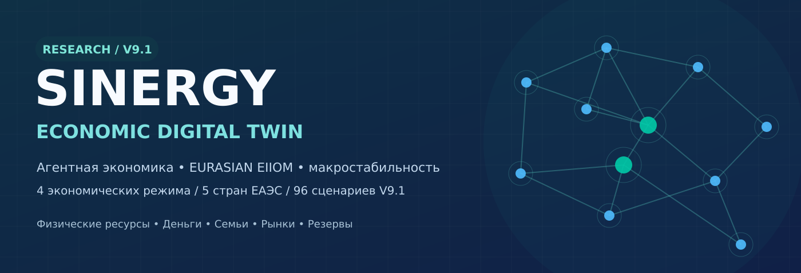
</p>

<p align="center">
  <strong>Российская и евразийская агентная экономика · Реальные производственные цепочки · Кибернетическое управление · Проверяемые денежные потоки</strong>
</p>

<p align="center">
  <a href="#-что-это-за-система">О системе</a> ·
  <a href="#-архитектура">Архитектура</a> ·
  <a href="#-eurasian-eiiom--производственная-экономика">EURASIAN EIIOM</a> ·
  <a href="#-сравнение-четырёх-экономик">Сравнение</a> ·
  <a href="#-панель-макроэкономических-показателей-v91">Показатели</a> ·
  <a href="#-запуск-и-воспроизведение">Запуск</a> ·
  <a href="#-доказательность-и-ограничения">Достоверность</a>
</p>

<p align="center">
  
  
  
  
  
</p>

> [!IMPORTANT]
> **SINERGY ECONOMIC DIGITAL TWIN — воспроизводимая исследовательская модель, а НЕ валидированный цифровой двойник России, СССР или пяти стран ЕАЭС.** Результаты ниже получены при частично синтетических технологических коэффициентах, валютных и рыночных предпосылках. Рост модельных акций, резервов или выпуска **не является прогнозом и не доказывает превосходство какой-либо экономической системы**.

---

# 🌍 Что это за система

**СИНЕРГИЯ** исследует, может ли экономика сочетать рыночную конкуренцию, планирование, подтверждённые физические инвестиции, финансовую устойчивость и кибернетическую обратную связь без скрытой денежной прибыли и без заранее назначенного победителя.

В основе не «печатать деньги и получить богатство», а полный производственный цикл:

**реальная потребность → проект → допустимое финансирование → энергия/материалы/кадры → строительство → выпуск товаров → продажи → реальные платежи → накопление капитала и новый цикл**.

Модель сравнивает **четыре институциональные конфигурации** на одинаковых исходных ресурсах и случайных шоках:

| Режим | Основной механизм | Важная оговорка |
|:--|:--|:--|
| 🟦 **Конкурентный капитализм** | Частные фирмы, рыночные решения, прибыль, индивидуальные активы | Упрощение; не историческая копия конкретной страны |
| 🟨 **СССР-подобное планирование** | Общественный капитал, централизованное распределение, коллективные доходы | Не реконструкция Госплана, Госбанка и советских нормативов |
| 🟪 **Современная смешанная РФ** | Фирмы, коммерческие банки, государство, налоги и трансферты | Макропараметры РФ калиброваны неполно |
| 🟩 **Кибернетическая СИНЕРГИЯ** | Сигналы дефицита, инвестиционные проекты, программируемая ликвидность и ограничения риска | Не реализован полный стохастический EIIOM-v4 |

**Принцип честного эксперимента:** никакому режиму не назначается прямой бонус производительности по названию. Денежные программы `baseline`, `escrow`, `demand`, `escrow_demand` доступны **каждой** из четырёх конфигураций. Наблюдаемые различия — свойства этой программной модели и её допущений, а не научный приговор реальным политико-экономическим системам.

## Исследовательский охват текущей V9.1

| Элемент | В текущем прототипе | Эмпирически подтверждено? |
|:--|--:|:--|
| Страновые узлы ЕАЭС | **5**: РФ, Казахстан, Беларусь, Армения, Кыргызстан | Страны настоящие; материальные мощности в модели синтетические |
| Агрегированных отраслей | **8** | Структура упрощена, коэффициенты не из таблиц Росстата |
| Архетипов EURASIAN | **24** направления | Названия из репозитория; проектные коэффициенты — допущения |
| Домохозяйств | **300 индивидуальных счетов** в V9 | Репрезентативные, не микроданные семей |
| Экспериментов V9.1 | **96** прогонов по 120 месяцев | Вычисления проведены, экономическая точность не доказана |
| Дополнительные тесты V9.1 | **12/12** | Внутренние технические тесты, не аудит ЦБ/Росстата |
| Курс USD/RUB | **120** месячных официальных наблюдений 2016–2025 | Да, внешний исторический ряд |

---

# 🧬 Архитектура

<p align="center">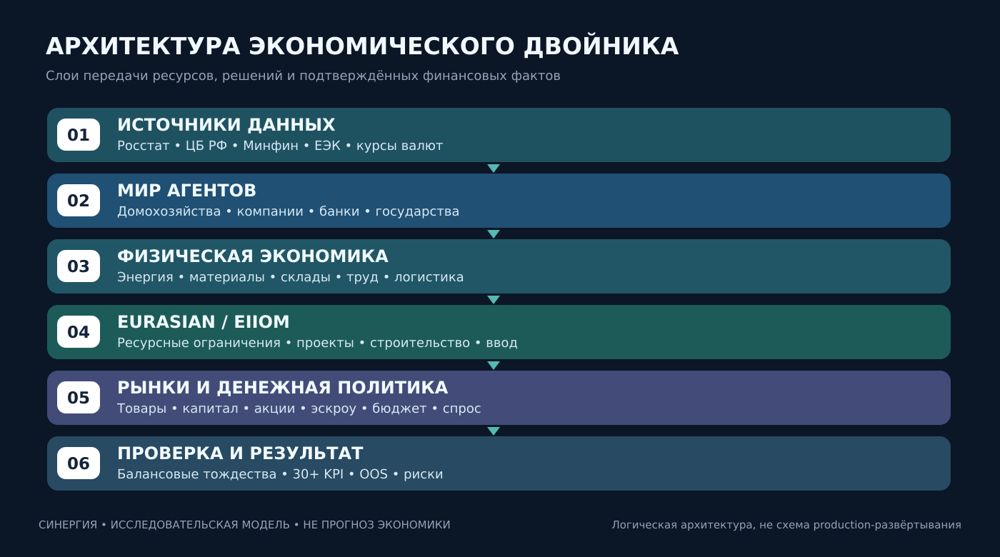</p>

### 1. Мир экономических агентов

Домохозяйства получают доход, владеют депозитами и рыночными долями, потребляют и получают адресную поддержку. Предприятия покупают промежуточные товары, платят работникам, производят и инвестируют. Банки обслуживают счета, учитывают кредиты и собственный капитал; государство собирает налоги и финансирует расходы; центральные банки имеют отдельные резервные счета.

**Ограничение:** многие решения заданы простыми поведенческими функциями, а не калиброванными моделями реального найма, входа/выхода фирм или стратегического поведения домохозяйств.

### 2. Физическая экономика: товар не равен деньгам

<p align="center">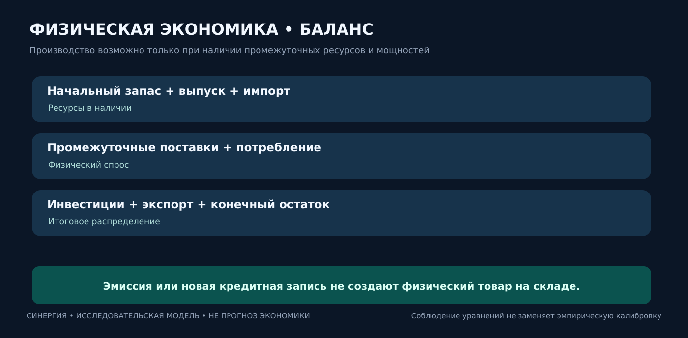</p>

Для каждого ресурса \(i\) экономика должна удовлетворять материальному балансу:

```text
Запас на начало + выпуск + импорт + входящие поставки
= производственное потребление + потребление семей
  + инвестиционные товары + экспорт + исходящие поставки
  + запас на конец + потери.
```

Производству одновременно нужны промежуточные компоненты, энергия, люди и оборудование. В отличие от старых версий, деньги сами по себе не превращаются в произведённый товар.

**Внешняя верификация ещё не пройдена:** реальная межотраслевая матрица 2016/2021, физические потоки по регионам и единицы МВт·ч / тонн / м³ требуют отдельной загрузки и калибровки.

### 3. Двойная запись и денежные ограничения

Отдельно ведутся обязательства банков, активы, кредит, денежное предложение, государственные бумаги и рефинансирование. Перевод между агентами должен изменять счета плательщика и получателя, а погашение кредита — сокращать одновременно денежное обязательство и кредитное требование.

**Отличать:** валовую эмиссию, депозитное создание кредита, капитал банка, резерв ЦБ, прибыль от внешней сделки, переоценку акции, HardNAV и реальную добавленную стоимость. Они не взаимозаменяемы.

---

# 🏭 EURASIAN EIIOM — производственная экономика

<p align="center">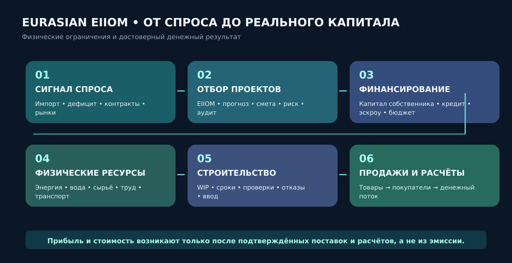</p>

Оригинальная архитектура — **[Shtenco/synergy_eurasian](https://github.com/Shtenco/synergy_eurasian)**. Её важнейшая идея — максимизировать не абстрактный оборот капитала, а проверяемую долгосрочную пользу вложений при **ограниченных физических ресурсах и внешнем платёжеспособном спросе**.

В репозитории действительно имеется **[исполняемый EIIOM-v2 LP-оптимизатор](https://github.com/Shtenco/synergy_eurasian/blob/main/src/eiiom_optimizer.py)** (`scipy.optimize.linprog`) с пятью странами и 24 направлениями. Более детальная архитектура **[EIIOM-v4 Stochastic Spatial MILP](https://github.com/Shtenco/synergy_eurasian/blob/main/docs/23_EIIOM_V4_STOCHASTIC_MILP.md)** пока преимущественно **спецификация**, а не готовый универсальный промышленный solver.

## 24 направления инвестиций

| Контур | Примеры направлений |
|:--|:--|
| ⚡ Энергетика и ресурсы | `PowerGen`, `Grid`, `MineralRefining`, `AdvancedMaterials`, `PowerElectronics` |
| 🧠 Вычисления и индустрия | `DataCenterInfra`, `Compute`, `AICloud`, `IndustrialAI`, `Robotics`, `MachineTools`, `SemiDesign` |
| 🚛 Транспорт и человеческий капитал | `Logistics`, `STEM` |
| 🌾 Агропромышленность | `AgroGenomics`, `SeedProduction`, `PrecisionAg`, `AgroRobotics`, `FoodProcessing`, `WaterIrrigation` |
| 🏘️ Территории, жильё, инфраструктура | `RuralAIClusters`, `UrbanRenovation`, `RuralHousing`, `ConstructionTech` |

**Пример взаимозависимости:** новый ЦОД не приносит выгоду без электросети, генерации, охлаждения, оборудования, специалистов и клиентов. Новая агротехника бесполезна без обслуживания, топлива, семян, воды и сбыта урожая. Именно эти ограничения должна выявлять EIIOM, а не добавлять сектору «коэффициент успеха».

## Механика запуска проектов

1. **Сигнал:** наблюдаемый дефицит, контракт, импорт или технологическое ограничение.
2. **Отбор:** конкурирующие проекты, отраслевые риски и прогноз ресурсной доступности.
3. **Денежный gate:** собственный капитал, долговая нагрузка, возможное рефинансирование и необходимые разрешения.
4. **Строительство:** оплаченный физический капитал переходит в `WIP`, а не мгновенно увеличивает выпуск.
5. **Ввод:** мощность вводится только после проверки ресурсов, срока и готовности.
6. **Эксплуатация:** поставки, реальные продажи, обслуживание долга и подтверждённая прибыль.

### Пять масштабов Дельты

[EURASIAN Capital Flywheel](https://github.com/Shtenco/synergy_eurasian/blob/main/docs/20_MULTI_SCALE_CAPITAL_FLYWHEEL.md) различает **семью → компанию → проект → регион → систему ЕАЭС**. На каждом уровне необходимы свои расходы, обязательства, обслуживание основного капитала, резервы и проверяемый денежный поток. Увеличение внутренних требований или собственного токена само по себе **не является приростом внешнего богатства**.

---

# 💳 ЦБ, эскроу-эмиссия и поддержка спроса

Исследуются четыре одинаково доступные для всех экономических режимов политики:

| Политика | Смысл | Что обязательно учитывается |
|:--|:--|:--|
| `baseline` | Обычные деньги, кредит и бюджет | Капитал банков, реальные ресурсы, долги |
| `escrow` | Условное финансирование подтверждённых производственных проектов | Залог, дополнительное кредитование, риск, WIP, обязательства ЦБ |
| `demand` | Адресные бюджетные выплаты | Фискальный источник, долг, инфляция, доступность товаров |
| `escrow_demand` | Две программы совместно | Все ограничения сразу; не гарантируется рост выпуска |

### Почему деньги не создают богатство автоматически

```text
Предложение эскроу → проверка пригодности проекта
                    → фактическое участие банка / обеспечение
                    → возвратное финансирование ЦБ
                    → физическая закупка ресурсов
                    → строительство / ввод
                    → производство / поставка / платёж
                    → обслуживание обязательств / реальная Δ.
```

> [!WARNING]
> Самая строгая версия **1:1 equity co-investment** ещё **не доказана независимой бухгалтерской проверкой источника капитала акционеров банка**. Некоторые экспериментальные транши остаются долговым финансированием. Проверка равенства программных счётчиков не заменяет проверку первичных проводок, блокировки обеспечения и погашения обязательств. **V9.1 не следует называть готовым законным механизмом эмиссии Банка России.**

---

# ⚖️ Сравнение четырёх экономик

Эксперимент использует **одинаковые физические технологии, начальные запасы и общие случайные шоки**. Для сравнительной тренировки V9 предусмотрен одинаковый бюджет поиска параметров. V9.1 применяет уже зафиксированные тренировочные веса: отдельная настройка под показатели 2023–2025 не выполнялась.

## Дизайн V9.1

| Параметр | Значение |
|:--|:--|
| Горизонт | 120 месяцев |
| TRAIN | 2016–2022, 84 месяца |
| Условный OOS | 2023–2025, последние 36 месяцев |
| Конфигураций | 4 режима × 4 политики × 2 состояния экономики |
| Завершённых запусков | **96**, по 2 семени на обычный сценарий и 4 на стрессовый |
| Главный сценарий ниже | Кризис + `escrow_demand`, средние по **4** семенам |
| Историческая привязка | USD/RUB 2016–2025; другие показатели РФ — для диагностического сравнения |

**Не следует трактовать исторические шоки как доказательство прогнозной способности:** в сценариях используется известный ex-post ряд USD/RUB. Микропараметры и реальный объём внешней торговли не калиброваны.

---

# 📊 Панель макроэкономических показателей V9.1

Ниже представлены разные экономические цели **одновременно**: выпуск, динамика цен, благосостояние людей, финансовые рынки, внешние активы и устойчивость. **Общего рейтинга или заранее назначенного победителя нет.** Все графики ниже воспроизведены из `results/crisis_escrow_demand_macro_dashboard.csv` исследовательского пакета V9.1.

## 01 / Реальная добавленная стоимость

<p align="center">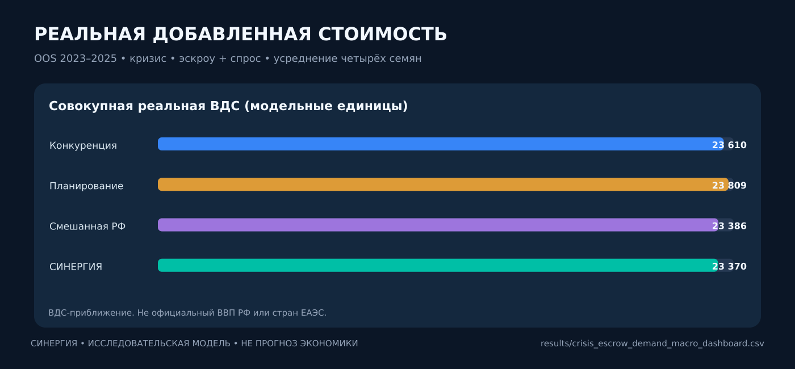</p>

Не путать **валовой выпуск**, **ВДС** и **ВВП**. Показанный показатель является приблизительной модельной ВДС, полученной из физического производства и промежуточных затрат. Полные национальные счета СНС и тройная сверка ВВП по производству, расходам и доходам ещё не построены.

## 02 / Рост и инфляция

<p align="center">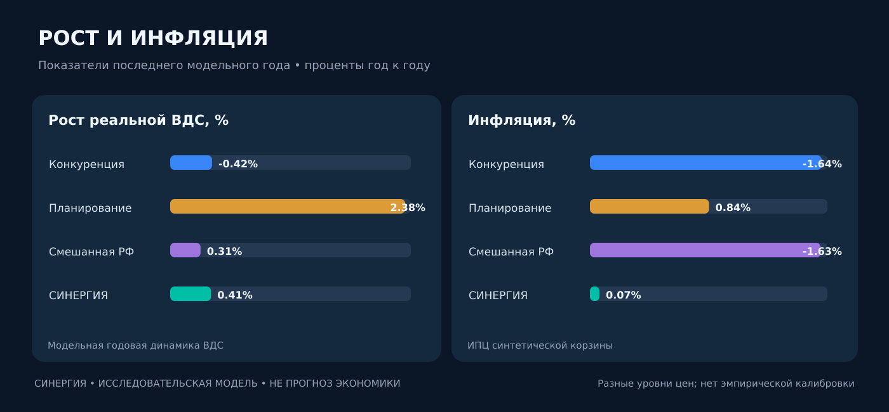</p>

Динамика реальной ВДС описывает рост **внутри модели**, а инфляция — движение **её синтетической потребительской корзины**. Эти значения не равны фактическому росту ВВП и официальному ИПЦ стран ЕАЭС.

## 03 / Благосостояние семей

<p align="center">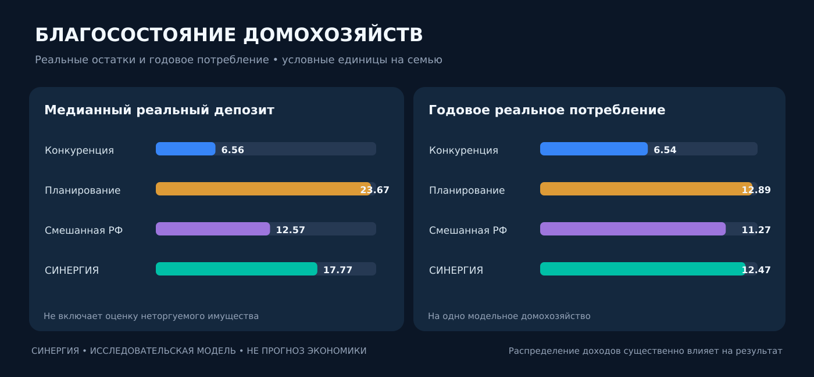</p>

Дополнительно рассчитываются среднее богатство, Джини, доля семей с малым ликвидным резервом и совокупное богатство с учётом торгуемых долей. **Медиана** важна, поскольку рост общего богатства может происходить при стагнации большинства семей.

## 04 / Акции, капитализация и внешние активы

<p align="center">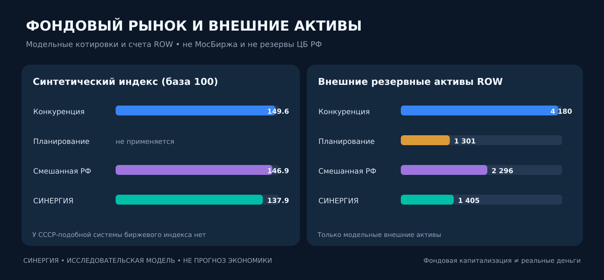</p>

Вторичный рынок моделирует сделки с долями и движение депозитов между инвесторами. **Капитализация не является денежным доходом**. СССР-подобная конфигурация не имеет фиктивного биржевого индекса; общественный капитал требует иной формы учёта.

Внешние активы создаются в расчётах против **остального мира (ROW)** после экспорта и уменьшаются при импорте. Взаимные требования стран ЕАЭС **не приравниваются** к внешним международным резервам. Показанные числа — **не золотовалютные резервы государств**.

## 05 / Банки и государственный долг

<p align="center">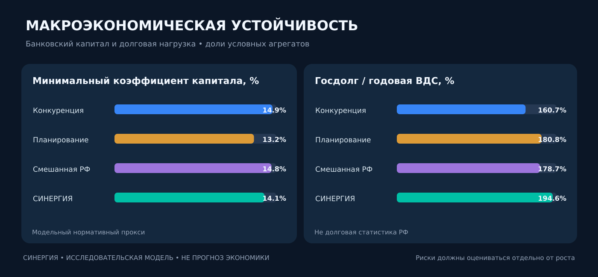</p>

Рост экономики, достигнутый одновременно с высоким долгом, нехваткой капитала банков или нестабильной инфляцией, не должен автоматически считаться успехом. Необходимы стресс-тесты, дефолты, внешние шоки и сценарии замедления выпуска.

## 06 / Проверка против фактических данных РФ

<p align="center">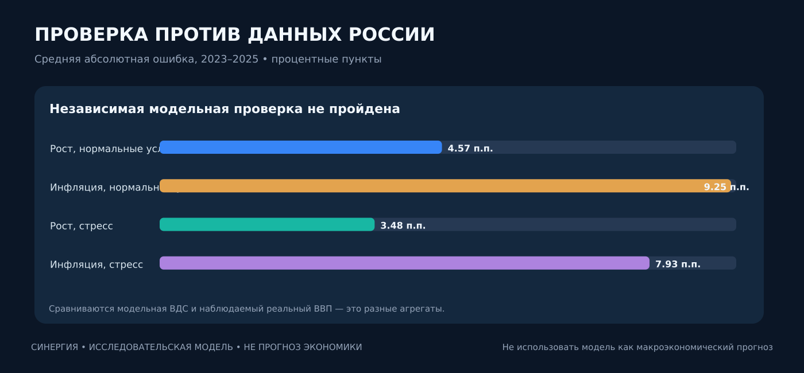</p>

Наблюдаемая ошибка смешанной конфигурации по 2023–2025 годам: **MAE роста порядка 3,48–4,57 п.п., инфляции 7,93–9,25 п.п.** В первом случае сравнивается модельная ВДС с реальным ВВП РФ, что само по себе требует оговорки о несопоставимости. **Калибровка не пройдена.**

### Полная таблица сравнения: кризис, `escrow_demand`

| Показатель | Капитализм | СССР-подобная | Смешанная РФ | СИНЕРГИЯ |
|:--|--:|--:|--:|--:|
| Реальная ВДС за 36 месяцев | 23 609,55 | 23 808,91 | 23 386,41 | 23 370,43 |
| Рост реальной ВДС в последний год | −0,42% | +2,38% | +0,31% | +0,41% |
| Инфляция последнего года | −1,64% | +0,84% | −1,63% | +0,07% |
| Медианный реальный депозит | 6,56 | 23,67 | 12,57 | 17,77 |
| Годовое реальное потребление / семью | 6,54 | 12,89 | 11,27 | 12,47 |
| Джини модельного богатства | 0,338 | 0,197 | 0,326 | 0,293 |
| Индекс акций, база 100 | 149,59 | Н/П | 146,94 | 137,90 |
| Внешние модельные резервные активы | 4 180,07 | 1 300,83 | 2 296,40 | 1 404,79 |
| Минимальный прокси капитала банков | 14,90% | 13,15% | 14,81% | 14,15% |
| Госдолг / годовая модельная ВДС | 160,75% | 180,76% | 178,69% | 194,65% |

**Единицы — модельные, не рубли, доллары, реальные люди или проценты настоящего фондового рынка.** Режимы отличаются правилами собственности, распределения и планирования; одновременная оптимизация реальных общественных предпочтений не выполнена.

---

# 📦 Исходный код и исследовательская история

<p align="center">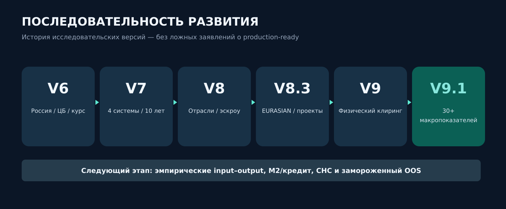</p>

### Версии и их вклад

| Версия | Что добавлено | Главный остающийся дефект |
|:--|:--|:--|
| **V6** | Российская привязка, ЦБ и исторический USD/RUB | Частичная макрокалибровка |
| **V7** | Четыре режима и парные сценарные испытания | Условные отрасли и институты |
| **V8** | Физические промежуточные потоки, эскроу и поддержка спроса | Матрица Росстата не внедрена |
| **V8.1–V8.2** | Кредит, наличные, бюджет, проверки М2 | Историческая денежная динамика не воспроизведена |
| **V8.3** | EURASIAN Project Factory, WIP, ввод и списание мощностей | Условные ресурсы и проектные коэффициенты |
| **V9** | Пять стран, склады, физический клиринг, торговля, отдельные бюджеты | Нет фактической 5-страновой матрицы IO |
| **V9.1** | Добавленная стоимость, инфляция, акции, реальные депозиты, внешние резервы и 30+ KPI | Непройденная независимая макропроверка |

### Навигация по GitHub

> Основное исполняемое исследование расположено в **ветке [`research/v8-russia-four-economies-escrow`](https://github.com/Shtenco/synergy_ai_economy/tree/research/v8-russia-four-economies-escrow)**. Пока исследования не слиты, `main` содержит документационную витрину, а не весь исполняемый пакет.

| Ресурс | Ссылка |
|:--|:--|
| Главный движок V9.1 | [`research/v9_1_macro_dashboard/src/macro_v91.py`](https://github.com/Shtenco/synergy_ai_economy/blob/research/v8-russia-four-economies-escrow/research/v9_1_macro_dashboard/src/macro_v91.py) |
| Физическое ядро V9 | [`src/twin.py`](https://github.com/Shtenco/synergy_ai_economy/blob/research/v8-russia-four-economies-escrow/research/v9_economic_digital_twin/src/twin.py) |
| Исполняемые исследования и проверки V9.1 | [`research/v9_1_macro_dashboard/`](https://github.com/Shtenco/synergy_ai_economy/tree/research/v8-russia-four-economies-escrow/research/v9_1_macro_dashboard) |
| Исходный проект EURASIAN | [`Shtenco/synergy_eurasian`](https://github.com/Shtenco/synergy_eurasian) |
| Слой финансовой бухгалтерии | [`Shtenco/synergy_financial_os`](https://github.com/Shtenco/synergy_financial_os) |
| Агентная экономика, денежные рынки | [`Shtenco/synergy_agentic_ai_economy`](https://github.com/Shtenco/synergy_agentic_ai_economy) |
| Данные 96 сценариев | [`results/all_96_runs.csv`](https://github.com/Shtenco/synergy_ai_economy/blob/research/v8-russia-four-economies-escrow/research/v9_1_macro_dashboard/results/all_96_runs.csv) |
| Групповые показатели | [`results/multi_kpi_group_stats.csv`](https://github.com/Shtenco/synergy_ai_economy/blob/research/v8-russia-four-economies-escrow/research/v9_1_macro_dashboard/results/multi_kpi_group_stats.csv) |
| Диагностика против Росстата | [`results/macro_validation_errors.csv`](https://github.com/Shtenco/synergy_ai_economy/blob/research/v8-russia-four-economies-escrow/research/v9_1_macro_dashboard/results/macro_validation_errors.csv) |
| Исследовательский PR | **[#1 — сценарная экономика России/ЕАЭС](https://github.com/Shtenco/synergy_ai_economy/pull/1)** |

---

# 🚀 Запуск и воспроизведение

Достаточно **Python 3.11+** и библиотек из `requirements.txt`. Запускать нужно **из каталога `research/v9_1_macro_dashboard` исследовательской ветки**, а не из корня `main`.

```bash
# Клонирование исследовательской версии
# (для приватного репозитория требуется доступ GitHub)
git clone --branch research/v8-russia-four-economies-escrow \
  https://github.com/Shtenco/synergy_ai_economy.git
cd synergy_ai_economy/research/v9_1_macro_dashboard

python -m pip install -r requirements.txt
python -m unittest discover -s tests -v

# Один кризисный набор, затем остальные четыре режима:
OPENBLAS_NUM_THREADS=1 python src/run_macro_v91.py --stress 1 --seeds 4 --mode capitalism
OPENBLAS_NUM_THREADS=1 python src/run_macro_v91.py --stress 1 --seeds 4 --mode soviet
OPENBLAS_NUM_THREADS=1 python src/run_macro_v91.py --stress 1 --seeds 4 --mode russia_mixed
OPENBLAS_NUM_THREADS=1 python src/run_macro_v91.py --stress 1 --seeds 4 --mode synergy

# Нормальный сценарий: те же четыре режима с --stress 0 --seeds 2
OPENBLAS_NUM_THREADS=1 python src/aggregate_v91.py
OPENBLAS_NUM_THREADS=1 python src/paths_figures.py
```

> [!NOTE]
> Репозиторий не выполняет реальных банковских платежей, не управляет средствами граждан и не отправляет финансовые сделки в рынок. Все действия происходят в исследовательской симуляции.

---

# 🔬 Доказательность и ограничения

| Утверждение | Статус | Как проверить |
|:--|:--|:--|
| Код V9.1 рассчитывает макропоказатели и записывает CSV | ✅ Воспроизводимый исследовательский эксперимент | Python + исходные данные + `results/` |
| Специализированные тесты V9.1 | ✅ 12/12 | `python -m unittest discover -s tests -v` |
| Исторический курс USD/RUB 2016–2025 | ✅ Источник — Банк России | `data/usdrub_2016_2025.csv` |
| Реальная межотраслевая матрица Росстата | ❌ Не интегрирована | Нужны подлинные XLSX 2016 и 2021 с hash/provenance |
| Исторические банковские балансы / М2 | ❌ Калибровка не пройдена | Нужны сопоставимые денежные агрегаты и контрагентные счета |
| Тройное равенство ВВП: производство = использование = доходы | ❌ Не реализовано в полном СНС | Независимые национальные счета |
| Полный 5-валютный платёжный баланс ЕАЭС | ❌ Не реализован | RUB/KZT/BYN/AMD/KGS и внешние активы |
| Полный EIIOM-v4 Spatial MILP | ❌ Пока спецификация / частичный упрощённый перенос | Регионы, проекты, физические единицы, непредвосхищение |
| Юридически допустимый банковский эскроу 1:1 | ❌ Нет независимой проверки источника equity | Проводки акционеров, рисковый капитал, залог и исполнение |
| Доказанное превосходство одной системы | ❌ Не установлено | Повторная калибровка, честный OOS, интервалы, абляции |

## Минимальные критерии следующей версии

- Загрузить **подлинные** межотраслевые таблицы Росстата, закрепить источник и SHA-256, вывести коэффициенты и независимые остатки.
- Построить **три метода ВВП** с единым счётом запасов, налогов на продукты и добавленной стоимости.
- Привязать реальные М2, наличные, корпоративный и потребительский кредит, госдолг и внешний сектор к **сопоставимым определениям** Банка России.
- В EURASIAN учесть электросети в МВт, энергию в МВт·ч, сырьё в тоннах, воду в м³, транспорт и труд **по квалификации и регионам**.
- В фондовом рынке учесть дивиденды, ликвидность, bid/ask, дефолты эмитентов и независимую оценку активов.
- Провести **одинаковый бюджет настройки всех четырёх режимов**, заморозить параметры и открыть результаты закрытого периода без подглядывания.
- Выводить **Парето-фронт** роста, благосостояния, инфляции, устойчивости, равенства и внешних активов без искусственно заданного идеологического победителя.

---

# 📚 Источники и методология

- [Росстат — статистика национальных счетов](https://rosstat.gov.ru/statistics/accounts) и [методология ВВП](https://rosstat.gov.ru/free_doc/new_site/vvp/metod.htm).
- [Банк России — статистика денежной массы и М2](https://www.cbr.ru/statistics/macro_itm/dkfs/methodological_commentary_ms/).
- [Банк России — международные резервы](https://www.cbr.ru/statistics/macro_itm/external_sector/ir/i-res_com/).
- [Банк России — динамика официального USD/RUB](https://www.cbr.ru/currency_base/dynamics/).
- [Московская биржа — индексы совокупного дохода](https://www.moex.com/ru/index/totalreturn/MEFNTR).
- [SYNERGY EURASIAN — исходники LP-v2](https://github.com/Shtenco/synergy_eurasian/blob/main/src/eiiom_optimizer.py) и [EIIOM-v4 Economic Compiler](https://github.com/Shtenco/synergy_eurasian/blob/main/docs/23_EIIOM_V4_STOCHASTIC_MILP.md).

---

<p align="center"><strong>SINERGY ECONOMIC DIGITAL TWIN</strong></p>
<p align="center">Физические активы → подтверждённые товары и услуги → реальные денежные потоки → воспроизводимое экономическое знание.</p>
<p align="center"><sub>Research / V9.1 · Документация не является предложением инвестиций, политической рекомендацией или обещанием экономического результата.</sub></p>